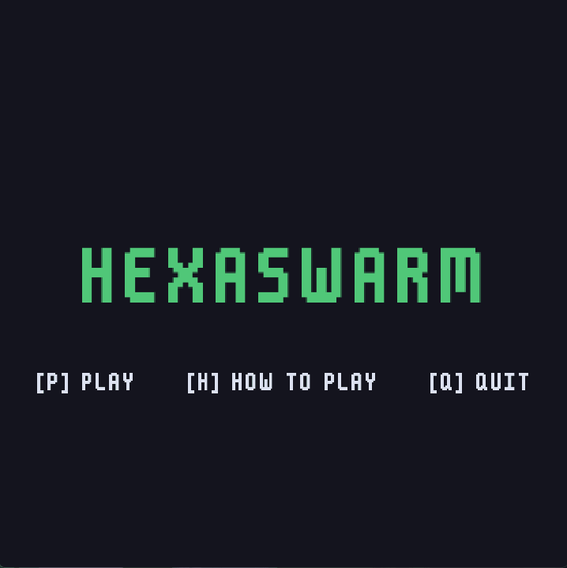
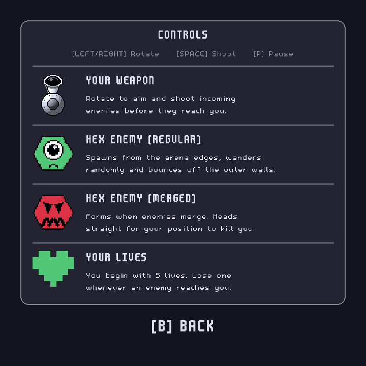
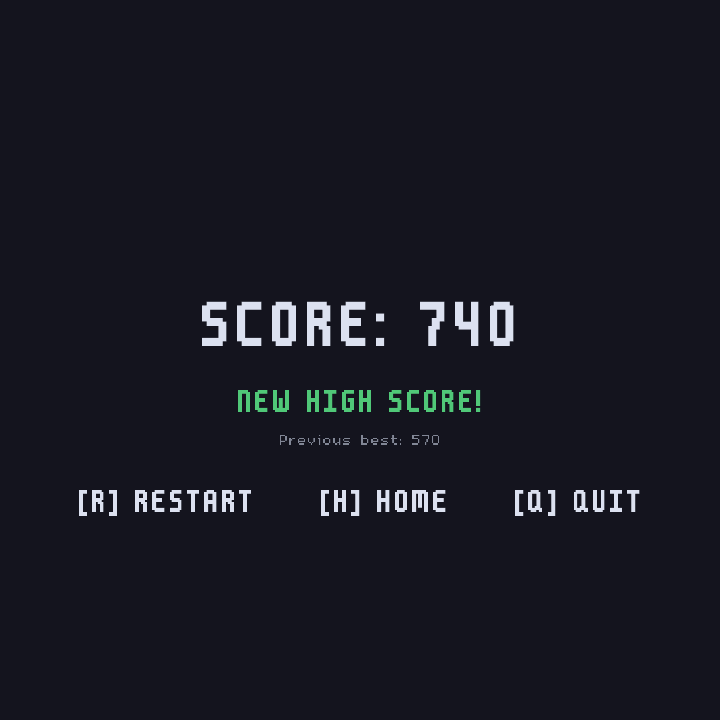

## HEXASWARM

### Description

HEXASWARM is a minimalist top-down survival shooter built for the **raylib 6.x Game Jam**. You control a stationary turret gun at the center of the arena — rotate, aim, and shoot down hexagonal enemies swarming in from every edge before they reach you. Enemies that wander too close to each other merge into a larger, more aggressive threat that abandons its random wandering and heads straight for you. Survive as long as you can, rack up your score, and try to beat your own high score.

### Features

- **Rotate-and-shoot combat** — a single turret gun, full 360° rotation.
- **Emergent enemy merging** — regular hex enemies that stay near each other combine into a bigger, faster, more dangerous merged enemy that hunts you directly
- **Persistent high score** — your best run is saved locally (desktop builds) and celebrated with a "New High Score" moment.

### Controls

Keyboard:
- `LEFT` / `RIGHT` — Rotate turret
- `SPACE` — Shoot
- `P` — Pause / Resume
- `H` — How To Play / Home (context-dependent menu shortcut)
- `R` — Restart
- `B` — Back (from "How To Play" screen)
- `Q` — Quit

### Screenshots

<table>
  <tr>
    <td align="center">
       
      Title Screen
    </td>
    <td align="center">
       
      Gameplay
    </td>
    <td align="center">
       
      Enemy Merge in Action
    </td>
  </tr>
  <tr>
    <td align="center">
       
      How To Play
    </td>
    <td align="center">
       
      Pause Overlay
    </td>
    <td align="center">
       
      New High Score
    </td>
  </tr>
</table>

### Developers

- Ashish ([itsAshDev](https://github.com/itsAshDev)) — Game design, programming, pixel art design, and all game systems

### Links

- itch.io Release: _TODO - add direct game page link once published_

### Credits / Third-Party Assets

- Built with [raylib](https://www.raylib.com/) by Ramon Santamaria ([@raysan5](https://github.com/raysan5)), on top of the [raylib gamejam template](https://github.com/raysan5/raylib-gamejam-template)
- Fonts: **m6x11** and **m5x7** by Daniel Linssen ([managore](https://managore.itch.io/))
- SFX: `hurt.ogg`, `select.ogg`, `shoot.ogg` — from Kenney's [Sci-Fi Sounds](https://kenney.nl/assets/sci-fi-sounds) asset pack. _(actual file names have been renamed)_
- SFX: `kill.wav`, `merge.wav` — generated with [rFXGen](https://raylibtech.itch.io/rfxgen) by raylibtech
- VFX: [`vfx.h`](./src/vfx.h) (muzzle flash, hit flash, death poof, merge pulse, hit vignette, heart-pop) — written with Claude

### License

This project's sources are licensed under an unmodified zlib/libpng license, which is an OSI-certified, BSD-like license that allows static linking with closed source software. Check [LICENSE](LICENSE) for further details.

Fonts and other third-party assets retain their own original licenses — see their respective sources linked above.

*Copyright (c) 2026 Ashish ([itsAshDev](https://github.com/itsAshDev))*